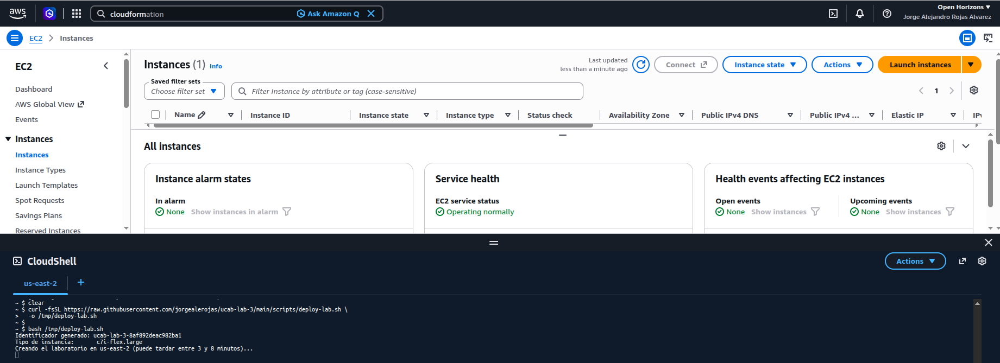
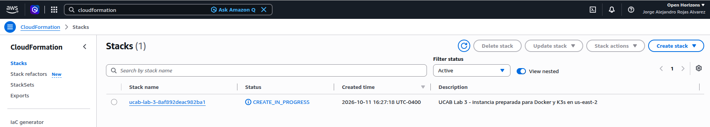
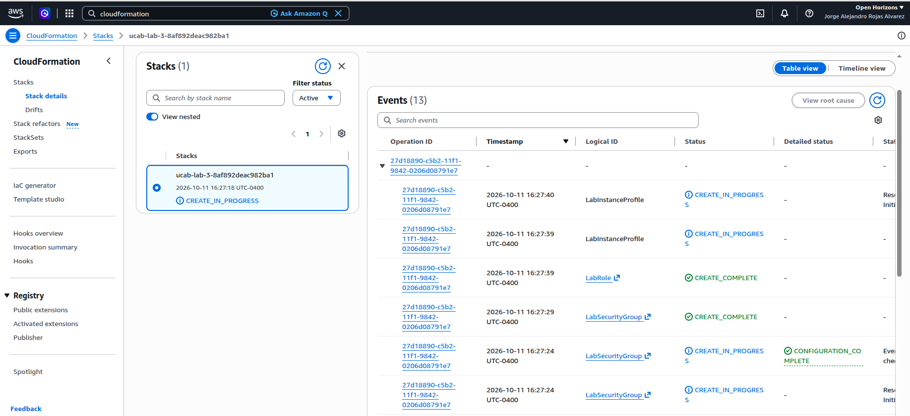
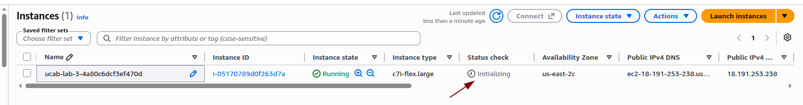
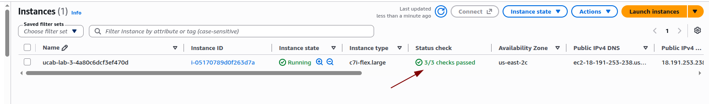

# Guía del laboratorio

**Duración:** 1 h 45 min

**Región:** US East (Ohio), `us-east-2`

**Meta:** llevar una API probada desde Docker hasta Kubernetes y observar cuándo aparece el valor de la orquestación.

> Ejecute los comandos uno por uno y lea qué hace cada uno antes de copiarlo. Observe el resultado indicado y deténgase si obtiene un error. Tome capturas legibles durante **todas las fases**: deben mostrar el comando ejecutado y su resultado. `evidence/evidence-template.md` es una lista de control opcional, no un formato obligatorio.

## 0–15 min — Preparar el entorno

### 1. Abrir CloudShell en Ohio

En la consola AWS, seleccione **US East (Ohio), `us-east-2`**. Pulse el icono de terminal de la barra superior para abrir CloudShell. Verifique que la pestaña de CloudShell también diga `us-east-2`, como en la captura:



### 2. Crear el laboratorio

Primero descargue el script de despliegue desde el repositorio. `curl` guarda el archivo en `/tmp/deploy-lab.sh`; si funciona, no muestra salida.

```bash
curl -fsSL https://raw.githubusercontent.com/jorgealerojas/ucab-lab-3/main/scripts/deploy-lab.sh -o /tmp/deploy-lab.sh
```

Ahora ejecute el script descargado. Este genera un identificador único y pide a CloudFormation que cree la infraestructura y prepare Docker y K3s.

```bash
bash /tmp/deploy-lab.sh
```

Debe aparecer `Identificador generado: ucab-lab-3-...` y luego `Creando el laboratorio`. Anote inmediatamente el identificador en su evidencia; no lo cambie ni invente uno. El comando permanecerá activo mientras CloudFormation trabaja.

### 3. Observar CloudFormation

Sin interrumpir el comando, abra **CloudFormation → Stacks** en otra pestaña. Busque el nombre que coincide con su identificador. Durante la preparación debe mostrar `CREATE_IN_PROGRESS`:



Pulse el nombre del stack. En **Stack details → Events** podrá observar cómo CloudFormation crea el rol, Security Group, Instance Profile, instancia y condición de espera. Actualice la lista con el botón circular de la esquina superior derecha:



Interprete los estados así:

- `CREATE_IN_PROGRESS`: el recurso continúa en preparación.
- `CREATE_COMPLETE`: el recurso terminó correctamente.
- `CREATE_FAILED`: abra el evento o pulse **View root cause** para leer la causa exacta.

No elimine recursos individuales desde **Events**. La creación y la limpieza deben realizarse siempre sobre el stack completo.

Espere a que CloudShell muestre `LABORATORIO LISTO` y a que el stack cambie a `CREATE_COMPLETE`. Puede tardar entre 3 y 8 minutos. No continúe si aparece `CREATE_FAILED` o `ROLLBACK_COMPLETE`; consulte [TROUBLESHOOTING.md](TROUBLESHOOTING.md).

### 4. Entrar a la instancia

Si la cuenta es compartida, no abra, modifique ni elimine el stack de otro estudiante. En **EC2 → Instances**, seleccione la instancia cuyo nombre coincide exactamente con su identificador.

Aunque **Instance state** ya muestre `Running`, no abra Session Manager mientras **Status check** diga `Initializing`. AWS todavía está comprobando el sistema, la instancia y el volumen adjunto:



Actualice la lista hasta que **Status check** muestre en verde `3/3 checks passed`. Solo entonces seleccione la instancia y abra **Connect → Session Manager**:



**Evidencia de preparación:** tome capturas del stack en `CREATE_COMPLETE`, de la instancia con `3/3 checks passed` y del resultado completo de `make doctor`. Deben verse su identificador de laboratorio y los estados, pero no exponga credenciales ni tokens.

**Preguntas para el informe:**

1. ¿Por qué `Running` no es suficiente para asumir que la instancia está lista?
2. ¿Qué valida `make doctor` que no se observa directamente en la consola EC2?
3. ¿Por qué cada estudiante debe entrar únicamente a la instancia cuyo nombre coincide con su identificador?

Cambie del usuario de Session Manager al usuario preparado para el laboratorio. El prompt debe pasar a mostrar `student`.

```bash
sudo -iu student
```

Entre al repositorio clonado durante el bootstrap. Este comando normalmente no produce salida; solo cambia el directorio actual.

```bash
cd ~/ucab-lab-3
```

Compruebe Docker, K3s, herramientas, región e identificador. Cada comprobación debe indicar `OK` y el resumen debe terminar con `Entorno listo`.

```bash
make doctor
```

La instancia EC2 es solo la plataforma del laboratorio; el trabajo evaluado comienza con Docker.

## 15–30 min — Conocer y probar la aplicación

Muestre el código de la API. Busque las rutas `/` y `/health`, las variables de entorno y la respuesta JSON.

```bash
sed -n '1,220p' app/src/app.js
```

Muestre las pruebas automatizadas. Debe identificar cuatro casos: ruta principal, salud, ruta inexistente y método no permitido.

```bash
sed -n '1,240p' app/test/app.test.js
```

Muestre el Dockerfile. Observe las etapas `test` y `runtime`, el usuario no privilegiado y el `HEALTHCHECK`.

```bash
sed -n '1,220p' app/Dockerfile
```

Ejecute las pruebas dentro de un contenedor temporal de Node.js 22. Esto valida la aplicación sin instalar Node.js directamente en la instancia.

```bash
make test
```

El resumen esperado contiene `tests 4`, `pass 4` y `fail 0`. Si alguna prueba falla, no continúe con la construcción de la imagen.

**Evidencia:** capture el comando `make test` y el resumen donde se vean las cuatro pruebas aprobadas. Incluya también un fragmento relevante del Dockerfile donde aparezca la etapa `test`.

**Preguntas para el informe:**

1. ¿Por qué `/health` tiene una respuesta más pequeña que `/`?
2. ¿Qué evita que se construya la imagen si una prueba falla?
3. ¿Cuál es la diferencia entre `APP_VERSION` y `APP_MESSAGE` en este laboratorio?

## 30–45 min — Construir una imagen y ejecutar un contenedor

Construya la versión `v1`. Docker ejecutará también las pruebas de la etapa `test` antes de producir la imagen final.

```bash
make image VERSION=v1
```

Debe terminar sin errores y mostrar una imagen etiquetada como `ucab-api:v1`.

Liste las imágenes de la aplicación para comprobar el repositorio, tag, identificador y tamaño.

```bash
docker image ls ucab-api
```

Inspeccione las capas que componen la imagen. La salida permite relacionar instrucciones del Dockerfile con capas reproducibles.

```bash
docker history ucab-api:v1
```

Inicie un contenedor llamado `ucab-api`, publique el puerto `8080` y configure el mensaje de la aplicación.

```bash
make run VERSION=v1
```

Docker debe devolver un identificador largo: es el ID del contenedor recién creado.

Realice una prueba HTTP contra el contenedor. El comando espera a que `/health` responda y luego muestra el JSON de `/`.

```bash
make smoke
```

La respuesta debe incluir `service`, `"version": "v1"`, `message` y `hostname`.

Inspeccione la configuración y el estado interno del contenedor.

```bash
make inspect
```

Busque el usuario `1000:1000`, las variables `APP_VERSION` y `APP_MESSAGE`, y la definición del healthcheck.

Liste los contenedores en ejecución para confirmar nombre, imagen, puertos y estado.

```bash
docker ps
```

Debe aparecer `ucab-api`, la imagen `ucab-api:v1` y el mapeo `8080->3000`.

Una imagen es la plantilla inmutable. `docker run` crea una instancia ejecutable con su propia identidad y capa escribible.

**Evidencia:** capture `docker image ls ucab-api`, la respuesta de `make smoke`, la inspección donde aparece `1000:1000` y `docker ps` con el puerto publicado.

**Preguntas para el informe:**

1. ¿Qué diferencia existe entre la imagen `ucab-api:v1` y el contenedor `ucab-api`?
2. ¿Por qué el contenedor ejecuta la aplicación como `1000:1000` en lugar de `root`?
3. ¿Qué función cumple el healthcheck y en qué se diferencia de comprobar solamente que el proceso existe?

## 45–57 min — Varias instancias y ausencia de reconciliación

Cree una segunda instancia de la misma imagen. Se llama `ucab-api-2`, escucha en el puerto `8081` y recibe un mensaje diferente.

```bash
docker run -d --name ucab-api-2 -p 8081:3000 -e APP_MESSAGE="Réplica Docker 2" ucab-api:v1
```

Docker debe devolver un nuevo ID de contenedor.

Cree una tercera instancia en el puerto `8082`.

```bash
docker run -d --name ucab-api-3 -p 8082:3000 -e APP_MESSAGE="Réplica Docker 3" ucab-api:v1
```

Docker debe devolver otro ID distinto.

Consulte la segunda instancia y formatee su JSON con `jq`.

```bash
curl -s http://127.0.0.1:8081/ | jq .
```

Debe mostrar el mensaje `Réplica Docker 2`. Anote su `hostname`.

Consulte la tercera instancia.

```bash
curl -s http://127.0.0.1:8082/ | jq .
```

Debe mostrar `Réplica Docker 3` y otro `hostname`. Los hostnames diferentes demuestran que son instancias independientes de la misma imagen.

Elimine deliberadamente la segunda instancia.

```bash
docker rm -f ucab-api-2
```

Docker debe imprimir `ucab-api-2`, confirmando su eliminación.

Liste los contenedores creados desde `ucab-api:v1`.

```bash
docker ps --filter ancestor=ucab-api:v1
```

`ucab-api-2` ya no debe aparecer. Espere unos segundos y ejecute exactamente el mismo comando otra vez: seguirá ausente. Docker ejecutó lo solicitado, pero nadie declaró que debían existir siempre tres réplicas. Esa ausencia prepara el problema que resolverá Kubernetes.

Elimine el contenedor principal mediante el objetivo de limpieza del Makefile.

```bash
make stop
```

Elimine también la tercera réplica para liberar puertos y memoria antes de iniciar K3s.

```bash
docker rm -f ucab-api-3
```

Debe imprimir `ucab-api-3`.

**Evidencia:** capture los tres contenedores en ejecución, las respuestas con hostnames diferentes y la lista posterior a eliminar `ucab-api-2`.

**Preguntas para el informe:**

1. ¿Cómo demuestra el hostname que los contenedores son instancias diferentes de una misma imagen?
2. ¿Por qué Docker no volvió a crear `ucab-api-2` después de eliminarlo?
3. ¿Qué capacidad falta aquí que luego aporta Kubernetes?

## 57–68 min — Iniciar Kubernetes y transferir la imagen

Inicie K3s y espere que su único nodo alcance la condición `Ready`.

```bash
make k8s-start
```

La salida esperada termina con `condition met`.

Consulte el nodo para ver su estado y versión de Kubernetes.

```bash
sudo k3s kubectl get nodes
```

Debe aparecer un nodo con `STATUS` igual a `Ready`.

Docker y K3s usan almacenes de imágenes distintos. Exporte `ucab-api:v1` desde Docker e impórtela en el `containerd` administrado por K3s.

```bash
make k8s-load VERSION=v1
```

El comando muestra información de importación y debe terminar sin errores.

Confirme que el almacén de K3s contiene la imagen.

```bash
sudo k3s ctr images list | grep ucab-api
```

Debe aparecer una referencia a `ucab-api:v1`.

Revise el Deployment. Busque `replicas: 3`, labels, probes, estrategia de actualización e imagen.

```bash
sed -n '1,240p' k8s/deployment.yaml
```

Revise el Service. Observe el selector y el puerto estable `30080`.

```bash
sed -n '1,160p' k8s/service.yaml
```

Revise el ConfigMap. Observe cómo el mensaje se separa de la imagen.

```bash
sed -n '1,120p' k8s/configmap.yaml
```

Relaciones que debe identificar:

```text
Deployment → desea 3 Pods
Service    → selecciona Pods por label
ConfigMap  → aporta configuración sin reconstruir la imagen
```

**Evidencia:** capture el nodo con estado `Ready`, la imagen `ucab-api:v1` dentro del almacén de K3s y los fragmentos de los manifiestos donde se vean réplicas, selector y configuración.

**Preguntas para el informe:**

1. ¿Por qué no basta con que la imagen exista en Docker y es necesario importarla en K3s?
2. ¿Qué estado declara el Deployment?
3. ¿Cómo relaciona el selector del Service a los Pods correctos?
4. ¿Qué ventaja ofrece el ConfigMap frente a escribir el mensaje dentro de la imagen?

## 68–82 min — Declarar y observar el estado deseado

Aplique todos los manifiestos y espere a que el Deployment termine.

```bash
make k8s-deploy
```

Debe ver `created` o `configured` para ConfigMap, Deployment y Service, seguido de `successfully rolled out`.

Muestre el estado del nodo, Deployment, Pods y Service.

```bash
make k8s-status
```

Compruebe que el Deployment indique `3/3` y que existan tres Pods `Running`.

Pruebe el NodePort desde la instancia.

```bash
make k8s-smoke
```

Debe recibir un JSON con `"version": "v1"` y el mensaje configurado por Kubernetes.

Envíe doce solicitudes al mismo endpoint y muestre únicamente el hostname de cada respuesta.

```bash
for i in {1..12}; do curl -s http://127.0.0.1:30080/ | jq -r '.hostname'; done
```

Debe observar más de un hostname. El `Service` conserva un endpoint mientras distribuye solicitudes entre Pods que pueden cambiar.

**Evidencia:** capture `make k8s-status` con tres Pods `Running`, la respuesta de `make k8s-smoke` y la secuencia de hostnames obtenida mediante el mismo endpoint.

**Preguntas para el informe:**

1. ¿Qué objeto garantiza las tres réplicas y qué objeto proporciona el endpoint estable?
2. ¿Por qué el cliente usa siempre el mismo puerto aunque respondan Pods diferentes?
3. ¿Qué evidencia demuestra que hubo distribución de solicitudes?

## 82–92 min — Escalado y autocuración

Cambie el estado deseado de tres a cuatro réplicas.

```bash
sudo k3s kubectl scale deployment/ucab-api --replicas=4
```

La salida debe indicar `deployment.apps/ucab-api scaled`.

Espere a que Kubernetes complete el escalado.

```bash
sudo k3s kubectl rollout status deployment/ucab-api
```

Debe terminar con `successfully rolled out`.

Liste los Pods para comprobar que ahora hay cuatro en estado `Running`.

```bash
sudo k3s kubectl get pods -l app.kubernetes.io/name=ucab-api
```

Seleccione automáticamente el nombre del primer Pod y guárdelo en la variable `POD`. Este comando no muestra salida.

```bash
POD=$(sudo k3s kubectl get pods -l app.kubernetes.io/name=ucab-api -o jsonpath='{.items[0].metadata.name}')
```

Compruebe qué nombre se guardó antes de eliminarlo.

```bash
echo "$POD"
```

Debe imprimir un nombre que comienza por `ucab-api-`.

Elimine ese Pod deliberadamente. El Deployment seguirá declarando cuatro réplicas.

```bash
sudo k3s kubectl delete pod "$POD"
```

Debe aparecer `pod/... deleted`.

Observe los Pods en tiempo real.

```bash
sudo k3s kubectl get pods -l app.kubernetes.io/name=ucab-api -w
```

Detenga la observación con `Ctrl+C` cuando aparezca un reemplazo `Running`. El nombre nuevo debe ser distinto: el controlador reconcilió el estado real con las cuatro réplicas declaradas.

Restaure el estado deseado original de tres réplicas.

```bash
sudo k3s kubectl scale deployment/ucab-api --replicas=3
```

La salida debe indicar nuevamente `scaled`.

**Evidencia:** capture los cuatro Pods antes de la eliminación y otra captura donde se vea el Pod sustituto con un nombre diferente. Registre el nombre eliminado y el nombre nuevo.

**Preguntas para el informe:**

1. ¿Qué componente detectó que faltaba una réplica?
2. ¿Por qué el Pod nuevo no conserva el nombre del Pod eliminado?
3. ¿Qué relación existe entre estado deseado, estado real y reconciliación?

## 92–99 min — Rolling update

Construya una nueva imagen etiquetada `v2`. El cambio de versión se inyecta durante el build.

```bash
make image VERSION=v2
```

Las cuatro pruebas deben pasar y Docker debe producir `ucab-api:v2`.

Importe `v2` al almacén de imágenes de K3s.

```bash
make k8s-load VERSION=v2
```

Debe terminar sin errores.

Cambie la imagen deseada del contenedor `api` dentro del Deployment.

```bash
sudo k3s kubectl set image deployment/ucab-api api=ucab-api:v2
```

La salida debe indicar `deployment.apps/ucab-api image updated`.

Observe el avance de la sustitución gradual.

```bash
sudo k3s kubectl rollout status deployment/ucab-api
```

Kubernetes crea Pods `v2` y retira los `v1` sin dejar el servicio sin réplicas disponibles. El comando termina con `successfully rolled out`.

Consulte el historial de revisiones del Deployment.

```bash
sudo k3s kubectl rollout history deployment/ucab-api
```

Debe mostrar al menos dos revisiones.

Compruebe la versión entregada por el Service.

```bash
curl -s http://127.0.0.1:30080/ | jq .
```

La respuesta debe contener `"version": "v2"`. La estrategia permite un Pod adicional y no permite ninguno no disponible (`maxSurge: 1`, `maxUnavailable: 0`).

**Evidencia:** capture el progreso o finalización del rollout, su historial de revisiones y la respuesta final donde aparezca `"version": "v2"`.

**Preguntas para el informe:**

1. ¿Qué cambió en el Deployment para iniciar el rolling update?
2. ¿Cómo influyen `maxSurge: 1` y `maxUnavailable: 0` durante la actualización?
3. ¿Qué evidencia confirma que la versión nueva quedó sirviendo tráfico?

## 99–102 min — Síntesis

Complete en la evidencia:

- imagen vs. contenedor;
- contenedor individual vs. Pod administrado;
- ejecución imperativa vs. estado deseado;
- qué aportaron Deployment, Service y ConfigMap;
- por qué este clúster de un nodo no representa alta disponibilidad.

Opcionalmente ejecute la verificación funcional automatizada. Esta comprueba réplicas, Service y versión desplegada.

```bash
make verify
```

El resultado esperado termina sin errores e informa que la verificación fue satisfactoria.

**Evidencia:** capture el resumen completo de `make verify`. Explique si la automatización confirmó los mismos comportamientos que observó manualmente.

## 102–105 min — Limpieza obligatoria

Dentro de la instancia, elimine los contenedores Docker y objetos Kubernetes creados por el ejercicio.

```bash
make clean
```

El comando puede mostrar objetos `deleted`; también es correcto que indique que alguno ya no existe.

Salga del usuario `student` y vuelva a la sesión administrada por AWS.

```bash
exit
```

Cierre la sesión de Session Manager.

```bash
exit
```

Regrese a CloudShell. Guarde en una variable el identificador exacto generado al principio. Sustituya únicamente el valor de ejemplo.

```bash
STACK_NAME="ucab-lab-3-a1b2c3d4e5f60708"
```

Compruebe visualmente el valor antes de borrar nada, especialmente si la cuenta es compartida.

```bash
echo "$STACK_NAME"
```

Solicite a CloudFormation la eliminación del stack completo. El comando normalmente no muestra salida.

```bash
aws cloudformation delete-stack --stack-name "$STACK_NAME" --region us-east-2
```

Espere hasta que AWS confirme la eliminación. Mientras espera, el comando no muestra progreso; al terminar correctamente vuelve al prompt sin salida.

```bash
aws cloudformation wait stack-delete-complete --stack-name "$STACK_NAME" --region us-east-2
```

Compruebe en **CloudFormation → Stacks** que el stack desapareció. No basta con detener la instancia: hay que eliminar el stack para retirar también volumen, Security Group, rol e Instance Profile.

**Evidencia de limpieza:** capture CloudShell después de que finalice `stack-delete-complete` y la consola de CloudFormation sin su stack. La captura debe permitir verificar el identificador eliminado.

## Informe a entregar

El formato del informe es **libre**: puede usar un documento, presentación o PDF con la estructura que considere más clara. La evaluación no depende de imitar una plantilla, sino de demostrar el trabajo realizado.

El informe debe contener como mínimo:

- nombre, cédula, sección y fecha;
- identificador exacto del laboratorio;
- capturas legibles y ordenadas de todas las fases solicitadas;
- una explicación breve de qué se hizo y qué demuestra cada evidencia;
- respuestas razonadas a todas las preguntas de la guía;
- evidencia del resultado de las pruebas y de la limpieza final.

No entregue una colección de capturas sin contexto. Cada imagen debe acompañarse de una descripción que indique el comando, el resultado relevante y la conclusión obtenida. Puede usar [evidence/evidence-template.md](evidence/evidence-template.md) como lista de control, adaptarla o crear su propia estructura.
